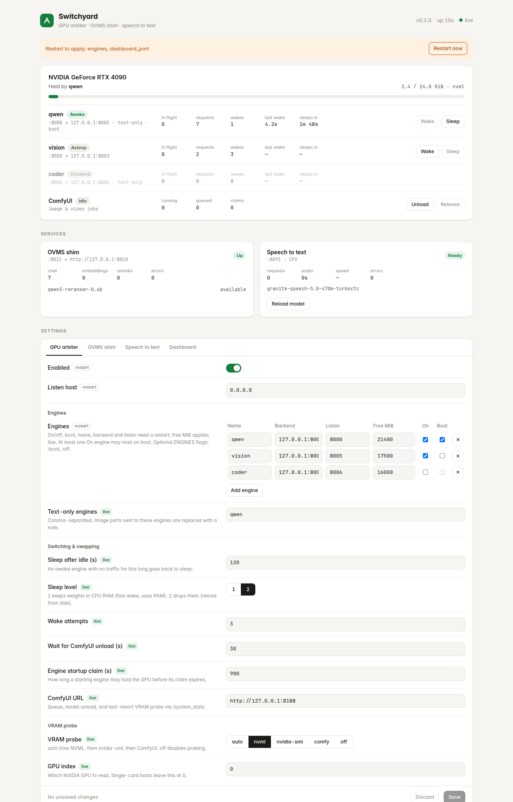
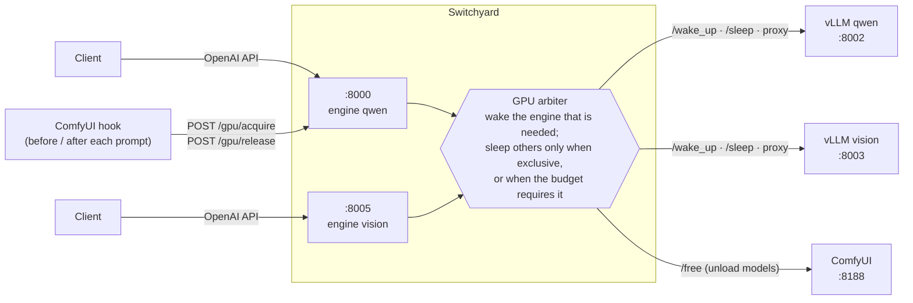

# Switchyard

[](https://github.com/dxbh0517/switchyard/actions/workflows/ci.yml)
[](https://github.com/dxbh0517/switchyard/releases)
[](LICENSE)
[](https://www.python.org/downloads/)

Share one NVIDIA GPU between several local AI services without them fighting over VRAM. Built for single-card stacks that are tired of juggling separate proxies. One small Python process with five optional parts:

- **GPU arbiter.** Several [vLLM](https://github.com/vllm-project/vllm) engines and [ComfyUI](https://github.com/Comfy-Org/ComfyUI) share a single NVIDIA GPU. By default only one of them holds the VRAM at a time (vLLM sleep mode or ComfyUI `/free`). Optional shared placement keeps several engines resident while their VRAM costs fit the card.
- **OVMS shim.** It makes [OpenVINO Model Server](https://github.com/openvinotoolkit/model_server) behave like a standard OpenAI-compatible server:
  - adds the response `id` that OVMS leaves out
  - wraps Qwen3-Reranker prompts
  - moves stray `</think>` text out of answers
  - maps `/v1` paths to `/v3`
- **Speech to text.** An OpenAI-compatible `/v1/audio/transcriptions` endpoint on the CPU. It uses Granite Speech CTC models through 🤗 Transformers.
- **Hub.** Tells clients such as Open WebUI how to use the stack well, all on one port.
  - Markdown guides for your ComfyUI models: settings that work, how to prompt each model, which LoRAs exist. Each guide is matched against ComfyUI's live model list, and installed files that no guide covers are listed separately.
  - Shared skills: `SKILL.md` folders.
  - An MCP endpoint, `/mcp`, with tools over the guides and skills. Shared HTTP MCP servers are proxied at `/mcp/<name>`, so a client only has to configure one host. See [docs/hub.md](docs/hub.md).
- **Dashboard.** Live status (owner, VRAM, wake/sleep) plus the settings that control the stack: which engines are on, which one loads on boot, and the switching knobs. Localhost only; there is no login.



Every part is optional, and nothing changes for clients: each one keeps its own port, so you can drop Switchyard in where separate proxies used to be. The arbiter and the shim only use the Python standard library. Speech to text adds `torch`, `transformers` and `ffmpeg`. An optional `nvml` extra (`nvidia-ml-py`) lets the arbiter read VRAM through NVML; without it, `nvidia-smi` or ComfyUI is used.

## How the GPU arbiter works



Ports match the default `ENGINES` value (`qwen=127.0.0.1:8002@8000:…,vision=127.0.0.1:8003@8005:…`): clients use the listen port, Switchyard forwards to the backend port.

- **When a request arrives:** In the default exclusive mode, Switchyard waits for any ComfyUI job and for other engines' requests to finish, puts the current owner to sleep or asks ComfyUI to unload, then wakes the requested engine and forwards the request. Responses are streamed, so SSE works.
- **Shared VRAM (`SHARED_VRAM=true`):** engines that already fit stay awake and serve in parallel. A wake that would exceed the card budget minus `VRAM_SAFETY_MB` waits only for the least-recently used victim's in-flight requests, then evicts it. Occupancy HTTP (sleep/wake/ComfyUI) does not hold the arbiter lock. ComfyUI still takes the whole GPU for a prompt. If the budget is unknown (no `VRAM_BUDGET_MB` and the VRAM probe has no total), shared mode falls back to exclusive eviction.
- **After `IDLE_SLEEP_SEC` without traffic:** that engine goes back to sleep, and the VRAM is free for whatever comes next.
- **Sleep levels:**
  - Level 2 drops the weights and reloads them from disk (the page cache when warm). Each sleeping engine keeps under 1 GiB of VRAM.
  - Level 1 keeps the weights in CPU RAM instead.
- **ComfyUI jobs:** the hook in [`comfyui_node/`](comfyui_node/gpu_arbiter) calls `/gpu/acquire` before each prompt and `/gpu/release` after it. If Switchyard can't be reached, ComfyUI runs normally.
- **Training (LoRA, fine-tuning):** run the trainer as `switchyard train -- python run.py job.yml`. Switchyard waits for running chat and ComfyUI work, sleeps every engine, unloads ComfyUI, and gives the trainer the whole card. Chat requests, ComfyUI prompts and engine loads wait until the command exits. The wrapper renews a lease while the trainer runs; if the wrapper is killed, the lease expires after `--ttl` seconds (default 300). `switchyard ctl training-end` force-releases a stuck reservation.
- **Engine startup:** an engine container calls `POST /gpu/loading?engine=NAME` before it starts `vllm serve`. Loads are serialized. Engines marked **boot** in the dashboard (or `:boot` in `ENGINES`) are woken once they are up; the rest stay parked until a request or a manual Wake.
- **Availability:** an engine with **On** unchecked (or `:off` in `ENGINES`) is not bound and is not woken. Apply that change with a restart.
- **Text-only engines:** image parts in requests to a text-only engine are replaced with a short note, so the request doesn't fail with HTTP 400.
- **VRAM:** free/used/total are read from the GPU when possible (NVML, then `nvidia-smi`), with ComfyUI `/system_stats` as a fallback. `/gpu/status` and the dashboard show the reading and which source produced it. If nothing can be read, wake and unload log a warning and continue.
- **Health:** a background thread probes each engine's `/health` and ComfyUI `/system_stats` every `HEALTH_INTERVAL_SEC` (HTTP calls do not hold the arbiter lock). State is `healthy`, `unhealthy`, or `unreachable`. An engine that is unhealthy, or unreachable after it has been up, is not sent traffic: clients get HTTP 503 with a `Retry-After` header. A failed wake (HTTP error, timeout, or still unhealthy after wake) is retried with exponential backoff (`WAKE_ATTEMPTS`, `WAKE_BACKOFF_SEC`). If every attempt fails, the engine is marked unhealthy, GPU ownership is released, and waiting requests fail fast instead of hanging. Traffic resumes automatically once a later health check succeeds.

## Quick start

### Docker

Copy [`docker-compose.example.yml`](docker-compose.example.yml) (Switchyard plus two vLLM engines; walkthrough in [docs/compose-two-engines.md](docs/compose-two-engines.md)) and adjust ports/models, or start from:

```yaml
# docker-compose.yml
services:
  switchyard:
    build: .                       # Dockerfile is at the repo root
    # build: { context: ., args: { WITH_STT: "0" } }  # stdlib-only image
    container_name: switchyard
    restart: unless-stopped        # the dashboard's "Restart" button relies on this
    network_mode: host             # reaches engines, ComfyUI and OVMS on localhost
    volumes:
      - ./models/granite-speech-5.0-470m-turboctc:/models/granite-speech-5.0-470m-turboctc:ro
      - switchyard-data:/data      # settings saved from the dashboard
    environment:
      - ENGINES=qwen=127.0.0.1:8002@8000:21400,vision=127.0.0.1:8003@8005:17500
      - TEXT_ONLY_ENGINES=qwen
      - COMFY_URL=http://127.0.0.1:8188
      - OVMS_UPSTREAM=http://127.0.0.1:8010
volumes:
  switchyard-data:
```

### From source

```sh
python3 -m pip install -e .
python3 -m switchyard --help     # commands, env vars and dashboard bind warning
python3 -m switchyard            # start; same as the `switchyard` console script
# Optional STT: python3 -m pip install -e ".[stt]"  (also needs ffmpeg)
# Optional NVML VRAM probe: python3 -m pip install -e ".[nvml]"
# Optional desktop tray: python3 -m pip install -e ".[tray]"  then `switchyard tray`
```

`ENGINES` is a comma-separated list of `name=backend_host:port@listen_port:free_MiB[:vram_MiB][:flag…]`. `free_MiB` is the free-VRAM target used before a wake (and the cost fallback). Optional `vram_MiB` is that engine's resident cost for shared placement. Optional flags: `boot` (wake this engine when Switchyard starts; at most one On engine) and `off` (do not bind or wake it). Clients send their requests to the listen port. The dashboard Engines table edits the same list.

When `vram_MiB` is omitted, the cost is the MiB measured after a successful wake, else a quantization-aware estimate if the engine dict has `n_params` (and optional `quant`, `context_length`, `n_layers`, `n_kv_heads`, `head_dim`, `kv_quant`), else `free_MiB`. The estimator also exposes `gpu_layers_that_fit` for llama.cpp-style partial offload; it is not wired into placement yet.

The vLLM engines must run with `--enable-sleep-mode` and `VLLM_SERVER_DEV_MODE=1`, which exposes `/sleep`, `/wake_up` and `/collective_rpc`. To have an engine claim the GPU before it loads, use an entrypoint like this one:

```yaml
    entrypoint:
      - /bin/sh
      - -c
      - |
        python3 -c "import urllib.request as u
        try: u.urlopen(u.Request('http://host.docker.internal:8000/gpu/loading?engine=qwen', data=b'{}', method='POST'), timeout=3600).read()
        except Exception as e: print('gpu claim skipped:', e)"
        exec vllm serve "$$@"
      - vllm-serve
```

To install the ComfyUI hook, copy `comfyui_node/gpu_arbiter` into `ComfyUI/custom_nodes/`. If Switchyard isn't reachable at `http://host.docker.internal:8000`, set `GPU_ARBITER_URL`.

Without Docker, run `python3 -m switchyard`. Set `SWITCHYARD_SETTINGS` to say where the settings file goes. `python3 -m switchyard --help` (or `switchyard --help`) prints the version, the subcommands (`ctl`, `tray`, `update`), key environment variables, and a reminder to keep the dashboard on localhost or set `SWITCHYARD_TOKEN`. `--version` prints the version and exits.

Telemetry of wake/sleep/load/unload and errors is stored in sqlite next to the settings file (`analytics.sqlite`). Set `SWITCHYARD_ANALYTICS_DB` to pick a path, or `SWITCHYARD_ANALYTICS=off` to disable it. Read it with `GET /api/history`.

## Settings

Settings come from three places. A value saved in the dashboard (written to `/data/settings.json`) overrides the environment variable, which overrides the built-in default. The dashboard marks each setting **live** (takes effect at once) or **restart** (applies after a restart; use the dashboard's *Restart* button).

**GPU arbiter**

| Variable | Default | Applies | Description |
|---|---|---|---|
| `ARBITER_ENABLED` | `true` | restart | Turns the arbiter on or off. |
| `ENGINES` | `qwen=127.0.0.1:8002@8000:21400,vision=127.0.0.1:8003@8005:17500` | restart | The vLLM engines sharing the GPU. Optional fifth field is `vram_mb`; optional `:boot` / `:off` flags. `free_mb` and `vram_mb` apply live; on/off and boot need a restart. |
| `TEXT_ONLY_ENGINES` | `qwen` | live | Comma-separated. Image parts sent to these engines are replaced with a note. |
| `COMFY_URL` | `http://127.0.0.1:8188` | live | ComfyUI address. Used to check the queue, unload models, and as a fallback VRAM probe. |
| `GPU_PROBE` | `auto` | live | How to read VRAM: `auto` (NVML → nvidia-smi → ComfyUI), or force `nvml` / `nvidia-smi` / `comfy`, or `off`. |
| `GPU_INDEX` | `0` | live | Which NVIDIA GPU to read. Single-card hosts leave this at 0. |
| `LISTEN_HOST` | `0.0.0.0` | restart | Address the arbiter, OVMS shim, and STT servers bind to. |
| `IDLE_SLEEP_SEC` | `120` | live | An awake engine with no traffic for this long goes back to sleep. |
| `SLEEP_LEVEL` | `2` | live | `1` keeps weights in CPU RAM (fast wake). `2` drops them (reload from disk). |
| `WAKE_ATTEMPTS` | `3` | live | How many times to try waking an engine before marking it unhealthy and returning HTTP 503. |
| `WAKE_BACKOFF_SEC` | `1` | live | Initial delay between wake attempts; doubles after each failure (1s, 2s, 4s, …). |
| `HEALTH_INTERVAL_SEC` | `15` | live | How often to probe vLLM `/health` and ComfyUI `/system_stats`. |
| `HEALTH_TIMEOUT_SEC` | `5` | live | HTTP timeout for each health probe, and for the post-wake health check. |
| `COMFY_FREE_WAIT_SEC` | `30` | live | How long to wait for ComfyUI's unload to free the target VRAM. |
| `LOADING_MAX_SEC` | `900` | live | How long a starting engine may hold the GPU before its claim expires. |
| `SHARED_VRAM` | `false` | live | Off: one occupant (today's behavior). On: keep several engines resident while they fit the budget; those engines serve in parallel. |
| `VRAM_BUDGET_MB` | `0` | live | Card size in MiB for shared placement. `0` = use the total from the VRAM probe (`GPU_PROBE`). |
| `VRAM_SAFETY_MB` | `1024` | live | Headroom subtracted from the budget so a wake does not OOM. |

**OVMS shim**

| Variable | Default | Applies | Description |
|---|---|---|---|
| `OVMS_SHIM_ENABLED` | `true` | restart | Turns the shim on or off. |
| `OVMS_SHIM_PORT` | `8012` | restart | Port the shim listens on (`LISTEN_HOST`). |
| `OVMS_UPSTREAM` | `http://127.0.0.1:8010` | live | OVMS REST address. |
| `RERANK_MODEL` | `qwen3-reranker-0.6b` | live | OVMS model name used for `/v1/rerank`. |
| `RERANK_INSTRUCTION` | `Given a web search query, …` | live | Default instruction in the Qwen3-Reranker prompt. |

**Speech to text**

| Variable | Default | Applies | Description |
|---|---|---|---|
| `STT_ENABLED` | `true` | restart | Turns speech to text on or off. |
| `STT_PORT` | `8091` | restart | Port the speech-to-text server listens on (`LISTEN_HOST`). |
| `STT_MODEL_PATH` | `/models/granite-speech-5.0-470m-turboctc` | live | Path to the model. Changing it reloads the model. |
| `STT_MODEL_ID` | `granite-speech-5.0-470m-turboctc` | live | Name reported by `/v1/models`. |
| `STT_THREADS` | `8` | live | CPU threads per transcription. |
| `STT_CHUNK_SEC` | `30` | live | Long audio is cut at the quietest point near each boundary. |

**Hub** (off by default; see [docs/hub.md](docs/hub.md))

| Variable | Default | Applies | Description |
|---|---|---|---|
| `HUB_ENABLED` | `false` | restart | Turns the hub on or off. |
| `HUB_HOST` | _(empty)_ | restart | Bind address. Empty means `LISTEN_HOST`. Because the hub proxies MCP servers, bind it narrowly (for example `127.0.0.1` or the docker bridge `172.17.0.1`) or set `HUB_TOKEN`. |
| `HUB_PORT` | `8120` | restart | Port the hub listens on. |
| `HUB_DIR` | `/data/hub` | live | Library folder: `models/*.md` (guides), `skills/`, `mcp.json` and `ignore.txt`. Re-read every few seconds. |
| `HUB_SKILLS_DIRS` | _(empty)_ | live | Extra comma-separated folders searched for `*/SKILL.md`. |
| `HUB_TOKEN` | _(empty)_ | live | When set, every hub request (MCP included) needs `Authorization: Bearer <token>`. |

**Dashboard**

| Variable | Default | Applies | Description |
|---|---|---|---|
| `DASHBOARD_HOST` | `127.0.0.1` | restart | Bind address. `127.0.0.1` is local only; `0.0.0.0` is reachable on the LAN. |
| `DASHBOARD_PORT` | `8100` | restart | Port the dashboard listens on. |
| `SWITCHYARD_TOKEN` | _(empty)_ | live | When set, the dashboard API requires `Authorization: Bearer <token>`. |

## Endpoints

| Port | Path | Purpose |
|---|---|---|
| engine ports | `/v1/*`, … | OpenAI API of that engine, woken on demand |
| engine ports | `GET /gpu/status` | arbiter state as JSON |
| engine ports | `POST /gpu/acquire`, `/gpu/release` | ComfyUI hook |
| engine ports | `POST /gpu/loading?engine=NAME` | engine startup claim |
| engine ports | `POST /gpu/training/begin?reason=&ttl=`, `/gpu/training/renew?lease=`, `/gpu/training/end?lease=` | whole-GPU lease for a trainer |
| `OVMS_SHIM_PORT` | `/v1/*`, `/v1/rerank` | OVMS with OpenAI compatibility fixes |
| `STT_PORT` | `POST /v1/audio/transcriptions`, `GET /v1/models`, `/health` | speech to text |
| `HUB_PORT` | `POST /mcp`, `/mcp/<name>`, `GET /models`, `/guides[/<slug>]`, `/skills[/<name>[/<file>]]`, `/mcp-servers`, `/search?q=` | hub: MCP server and gateway, model guides, skills |
| `DASHBOARD_PORT` | `/`, `/api/info`, `/api/status`, `/api/settings`, `/api/plugins`, `/api/action`, `/api/logs`, `/api/history`, `/api/restart` | dashboard |

`GET /api/settings` includes `sections` (Engines, Switching & swapping, Health checks, VRAM probe, Shared VRAM budget) and per-engine `enabled` / `boot`.

`GET /api/info` is unauthenticated (`version`, bind `host`, `auth_required`). Everything else under `/api/` needs the bearer token when `SWITCHYARD_TOKEN` is set. Mutating paths accept `POST` only, plus a same-origin `Origin` or the `X-Switchyard` header.

## Remote dashboard

The dashboard talks to the same Switchyard process that owns the GPU arbiter. By default it listens on `127.0.0.1:8100`, so only that machine can open it. To use it from another computer:

**Bind on the LAN and set a token**

```sh
export DASHBOARD_HOST=0.0.0.0
export SWITCHYARD_TOKEN=$(python3 -c "import secrets; print(secrets.token_urlsafe(32))")
python3 -m switchyard
# On the other machine: http://<gpu-host>:8100/
```

The page asks for the token once, stores it in `localStorage`, and sends it on every `fetch`. Binding off loopback with an empty token logs a warning and shows a banner in the UI.

**SSH tunnel** (dashboard stays on localhost)

```sh
ssh -L 8100:127.0.0.1:8100 user@gpu-host
# open http://127.0.0.1:8100/ on your laptop
```

Leave `DASHBOARD_HOST=127.0.0.1`. No token is required.

Scripts talking to the API from outside a browser must send the CSRF header:

```sh
curl -sH "Authorization: Bearer $SWITCHYARD_TOKEN" -H "X-Switchyard: 1" \
  -H "Content-Type: application/json" -d '{"idle_sleep_sec": 60}' \
  http://gpu-host:8100/api/settings
```

Switchyard speaks HTTP only. For TLS, put Caddy, nginx, or another reverse proxy in front and terminate HTTPS there.

## CLI

`switchyard ctl` (also installed as `switchyardctl`, or `python -m switchyard ctl`) talks to a **running** Switchyard over that dashboard JSON API. It does not start the arbiter, and it does not duplicate wake/sleep/unload logic.

```sh
# on the GPU box (dashboard defaults to 127.0.0.1:8100)
switchyard ctl status
switchyard ctl engines
switchyard ctl wake qwen          # aliases: load, swap (give this engine the GPU)
switchyard ctl sleep vision       # alias: unload
switchyard ctl comfy-unload
switchyard ctl budget             # VRAM / memory numbers the server exposes today
switchyard ctl --json status      # --json also works after the command
```

`--host` / `--port` override the dashboard address. `SWITCHYARD_URL` (for example `http://127.0.0.1:8100`) is used when they are omitted. `--token` or `SWITCHYARD_TOKEN` is sent as `Authorization: Bearer …` (needed when the server sets `SWITCHYARD_TOKEN`). `ctl` sends the `X-Switchyard` header, so it passes the CSRF check without an `Origin`.

SSH from a laptop, with the dashboard staying on localhost:

```sh
ssh gpu-box 'switchyard ctl status'
ssh gpu-box 'switchyardctl swap qwen'

# or tunnel the dashboard and run ctl locally
ssh -L 8100:127.0.0.1:8100 gpu-box
export SWITCHYARD_URL=http://127.0.0.1:8100
switchyard ctl status
```

Unreachable servers and HTTP errors print a short message on stderr and exit non-zero. Extra fields that later builds may add (GPU probe source, shared-VRAM budget, …) are shown when present and ignored when missing.

## Desktop tray

A system tray / menu bar client talks to a running Switchyard over HTTP. The core server stays standard-library only; the tray is an optional extra.

```sh
python3 -m pip install -e ".[tray]"     # from a checkout; "switchyard" on PyPI is an unrelated project
switchyard tray                          # or: python -m switchyard.tray
switchyard tray --url http://127.0.0.1:8100
```

`SWITCHYARD_URL` overrides the default dashboard (`http://127.0.0.1:8100`, or `DASHBOARD_HOST`/`DASHBOARD_PORT` when set). The menu shows live GPU VRAM from `/gpu/status` (used/total, including older servers that only report free/total) and system RAM via psutil. Modes:

- **Exclusive** — one owner at a time (today's default).
- **Shared VRAM** — shown when the server advertises `shared_vram` (or a placement/budget field). Toggles that setting; hidden on older servers.
- **Give GPU to** an engine (`POST /api/action` `warm`) or ComfyUI (sleeps every awake engine; ComfyUI loads its models on its next prompt).
- **Clear all** — sleeps every engine and unloads ComfyUI. Asks for confirmation when a dialog is available.

**Open dashboard** uses the system browser. If the server is unreachable the icon turns red and the menu offers Retry.

Local tray settings (`check_updates`, optional URL) live in `~/.config/switchyard/tray.json` (macOS: `~/Library/Application Support/switchyard/tray.json`, Windows: `%APPDATA%\switchyard\tray.json`). Override the path with `SWITCHYARD_TRAY_CONFIG`.

### Linux caveats

pystray prefers **AppIndicator**. GNOME Shell does not show app indicators unless you install an extension such as [AppIndicator and KStatusNotifierItem Support](https://extensions.gnome.org/extension/615/appindicator-support/). Without AppIndicator or GTK, pystray falls back to **Xorg**: the icon is visible but the menu is not (a left-click runs the default item, Open dashboard). Set `PYSTRAY_BACKEND=appindicator` to force that backend. Wayland sessions need AppIndicator or GTK; the Xorg backend will not work there.

### Autostart

**Linux.** A user systemd service or a desktop file:

```ini
# ~/.config/autostart/switchyard-tray.desktop
[Desktop Entry]
Type=Application
Name=Switchyard
Exec=switchyard tray
X-GNOME-Autostart-enabled=true
```

```ini
# ~/.config/systemd/user/switchyard-tray.service
[Service]
ExecStart=switchyard tray
Restart=on-failure
[Install]
WantedBy=default.target
```

Then `systemctl --user enable --now switchyard-tray`.

**macOS.** Save a LaunchAgent at `~/Library/LaunchAgents/com.switchyard.tray.plist` with `ProgramArguments` `switchyard` and `tray`, then `launchctl load` it. Or System Settings → General → Login Items.

**Windows.** `Win+R`, `shell:startup`, and a shortcut to `switchyard-tray` (a GUI entry point, so no console window) or `switchyard tray`.

The tray does not start the server. Start Switchyard first (Docker or `python3 -m switchyard`).

## Updating

```sh
switchyard update            # show what's new; ask before installing
switchyard update --yes      # print notes, then pip-install (never silent)
```

The check uses the standard library (`urllib`, `json`) against GitHub releases, then tags, of [dxbh0517/switchyard](https://github.com/dxbh0517/switchyard). No releases yet, being offline, and API rate limits are reported instead of crashing. Compared against the installed `__version__`.

- **pip install** — after you confirm, upgrades from the git tag (`git+https://github.com/dxbh0517/switchyard.git@vX.Y.Z`). PyPI is never used: the `switchyard` name there belongs to an unrelated project.
- **Docker / source** — notify only, with rebuild / `git pull` instructions. Nothing is installed automatically. An editable install (`pip install -e .`) counts as source, so your checkout is never replaced.

The tray has a **Check for updates** item (same lookup, still confirms before installing). **Check periodically** is off by default; turn it on from the menu to poll GitHub at most once a day.

## Development

```sh
python3 -m pip install -e .
python3 -m unittest discover -s tests     # fake vLLM/ComfyUI/OVMS; tray/updater tests mock the network
# Optional: python3 -m pip install -e ".[tray]"  — runs make_icon; pystray GUI is still skipped without Gtk
```

See [CONTRIBUTING.md](CONTRIBUTING.md) for setup, PR expectations, and [good first issues](https://github.com/dxbh0517/switchyard/labels/good%20first%20issue). Third-party GPU occupants can be dropped in as engine adapters; the contract and loader are documented in [docs/plugins.md](docs/plugins.md) (the arbiter does not route traffic through them yet).

## License

MIT — see [LICENSE](LICENSE).
