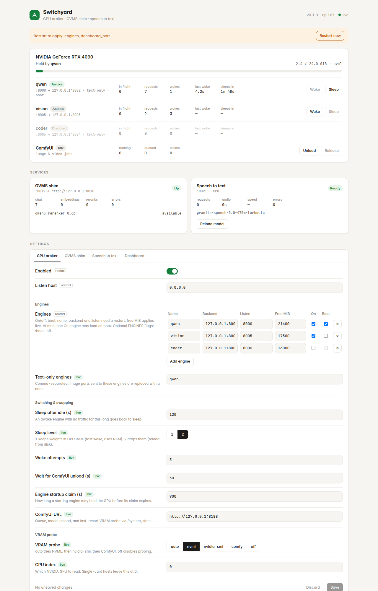

# Switchyard

[](https://github.com/dxbh0517/switchyard/actions/workflows/ci.yml)
[](LICENSE)
[](https://www.python.org/downloads/)

Share one NVIDIA GPU between several local AI services without them fighting over VRAM. Built for single-card stacks that are tired of juggling separate proxies. One small Python process with four optional parts:

- **GPU arbiter.** Several [vLLM](https://github.com/vllm-project/vllm) engines and [ComfyUI](https://github.com/Comfy-Org/ComfyUI) take turns on a single NVIDIA GPU. Only one of them holds the VRAM at a time. The others are kept in vLLM's sleep mode or unloaded, and are woken up when a request for them arrives.
- **OVMS shim.** It makes [OpenVINO Model Server](https://github.com/openvinotoolkit/model_server) behave like a standard OpenAI-compatible server:
  - adds the response `id` that OVMS leaves out
  - wraps Qwen3-Reranker prompts
  - moves stray `</think>` text out of answers
  - maps `/v1` paths to `/v3`
- **Speech to text.** An OpenAI-compatible `/v1/audio/transcriptions` endpoint on the CPU. It uses Granite Speech CTC models through 🤗 Transformers.
- **Dashboard.** Shows the live state of the parts above and lets you edit their settings.



Every part is optional, and nothing changes for clients: each one keeps its own port, so you can drop Switchyard in where separate proxies used to be. The arbiter and the shim only use the Python standard library. Speech to text adds `torch`, `transformers` and `ffmpeg`.

## How the GPU arbiter works

```
client ──► :8000 (engine "qwen") ──┐
client ──► :8005 (engine "vision") ─┼──► Switchyard ──► wake the one engine that is needed,
ComfyUI ──► POST /gpu/acquire ──────┘                   put the others to sleep / unload ComfyUI
```

- **When a request arrives:** Switchyard first waits for any ComfyUI job and for other engines' requests to finish. Next, it puts the current owner to sleep, or asks ComfyUI to unload its models. Then it wakes the requested engine and forwards the request. Responses are streamed, so SSE works.
- **After `IDLE_SLEEP_SEC` without traffic:** the engine goes back to sleep, and the VRAM is free for whatever comes next.
- **Sleep levels:**
  - Level 2 drops the weights and reloads them from disk (the page cache when warm). Each sleeping engine keeps under 1 GiB of VRAM.
  - Level 1 keeps the weights in CPU RAM instead.
- **ComfyUI jobs:** the hook in [`comfyui_node/`](comfyui_node/gpu_arbiter) calls `/gpu/acquire` before each prompt and `/gpu/release` after it. If Switchyard can't be reached, ComfyUI runs normally.
- **Engine startup:** an engine container calls `POST /gpu/loading?engine=NAME` before it starts `vllm serve`. Loads are serialized, and each engine is put to sleep as soon as it is up.
- **Text-only engines:** image parts in requests to a text-only engine are replaced with a short note, so the request doesn't fail with HTTP 400.

## Quick start

### Docker

Copy [`docker-compose.example.yml`](docker-compose.example.yml) and adjust ports/models, or start from:

```yaml
# docker-compose.yml
services:
  switchyard:
    build: .                       # Dockerfile is at the repo root
    # build: { context: ., args: { WITH_STT: "0" } }  # stdlib-only image
    container_name: switchyard
    restart: unless-stopped        # the dashboard's "Restart" button relies on this
    network_mode: host             # reaches engines, ComfyUI and OVMS on localhost
    volumes:
      - ./models/granite-speech-5.0-470m-turboctc:/models/granite-speech-5.0-470m-turboctc:ro
      - switchyard-data:/data      # settings saved from the dashboard
    environment:
      - ENGINES=qwen=127.0.0.1:8002@8000:21400,vision=127.0.0.1:8003@8005:17500
      - TEXT_ONLY_ENGINES=qwen
      - COMFY_URL=http://127.0.0.1:8188
      - OVMS_UPSTREAM=http://127.0.0.1:8010
volumes:
  switchyard-data:
```

### From source

```sh
python3 -m pip install -e .
python3 -m switchyard --help     # commands and env vars
python3 -m switchyard            # start; same as the `switchyard` console script
# Optional STT: python3 -m pip install -e ".[stt]"  (also needs ffmpeg)
# Optional desktop tray: python3 -m pip install -e ".[tray]"  then `switchyard tray`
```

`ENGINES` is a comma-separated list of `name=backend_host:port@listen_port:free_MiB_needed_to_wake`. Clients send their requests to the listen port.

The vLLM engines must run with `--enable-sleep-mode` and `VLLM_SERVER_DEV_MODE=1`, which exposes `/sleep`, `/wake_up` and `/collective_rpc`. To have an engine claim the GPU before it loads, use an entrypoint like this one:

```yaml
    entrypoint:
      - /bin/sh
      - -c
      - |
        python3 -c "import urllib.request as u
        try: u.urlopen(u.Request('http://host.docker.internal:8000/gpu/loading?engine=qwen', data=b'{}', method='POST'), timeout=3600).read()
        except Exception as e: print('gpu claim skipped:', e)"
        exec vllm serve "$$@"
      - vllm-serve
```

To install the ComfyUI hook, copy `comfyui_node/gpu_arbiter` into `ComfyUI/custom_nodes/`. If Switchyard isn't reachable at `http://host.docker.internal:8000`, set `GPU_ARBITER_URL`.

Without Docker, run `python3 -m switchyard`. Set `SWITCHYARD_SETTINGS` to say where the settings file goes.

## Settings

Settings come from three places. A value saved in the dashboard (written to `/data/settings.json`) overrides the environment variable, which overrides the built-in default. The dashboard marks each setting **live** (takes effect at once) or **restart** (applies after a restart; use the dashboard's *Restart* button).

**GPU arbiter**

| Variable | Default | Applies | Description |
|---|---|---|---|
| `ARBITER_ENABLED` | `true` | restart | Turns the arbiter on or off. |
| `ENGINES` | `qwen=127.0.0.1:8002@8000:21400,vision=127.0.0.1:8003@8005:17500` | restart | The vLLM engines sharing the GPU. The free-VRAM target applies live. |
| `TEXT_ONLY_ENGINES` | `qwen` | live | Comma-separated. Image parts sent to these engines are replaced with a note. |
| `COMFY_URL` | `http://127.0.0.1:8188` | live | ComfyUI address. Used to read VRAM, check the queue and unload models. |
| `LISTEN_HOST` | `0.0.0.0` | restart | Address the engine ports bind to. |
| `IDLE_SLEEP_SEC` | `120` | live | An awake engine with no traffic for this long goes back to sleep. |
| `SLEEP_LEVEL` | `2` | live | `1` keeps weights in CPU RAM (fast wake). `2` drops them (reload from disk). |
| `WAKE_ATTEMPTS` | `3` | live | How many times to try waking an engine before returning HTTP 503. |
| `COMFY_FREE_WAIT_SEC` | `30` | live | How long to wait for ComfyUI's unload to free the target VRAM. |
| `LOADING_MAX_SEC` | `900` | live | How long a starting engine may hold the GPU before its claim expires. |

**OVMS shim**

| Variable | Default | Applies | Description |
|---|---|---|---|
| `OVMS_SHIM_ENABLED` | `true` | restart | Turns the shim on or off. |
| `OVMS_SHIM_PORT` | `8012` | restart | Port the shim listens on. |
| `OVMS_UPSTREAM` | `http://127.0.0.1:8010` | live | OVMS REST address. |
| `RERANK_MODEL` | `qwen3-reranker-0.6b` | live | OVMS model name used for `/v1/rerank`. |
| `RERANK_INSTRUCTION` | `Given a web search query, …` | live | Default instruction in the Qwen3-Reranker prompt. |

**Speech to text**

| Variable | Default | Applies | Description |
|---|---|---|---|
| `STT_ENABLED` | `true` | restart | Turns speech to text on or off. |
| `STT_PORT` | `8091` | restart | Port the speech-to-text server listens on. |
| `STT_MODEL_PATH` | `/models/granite-speech-5.0-470m-turboctc` | live | Path to the model. Changing it reloads the model. |
| `STT_MODEL_ID` | `granite-speech-5.0-470m-turboctc` | live | Name reported by `/v1/models`. |
| `STT_THREADS` | `8` | live | CPU threads per transcription. |
| `STT_CHUNK_SEC` | `30` | live | Long audio is cut at the quietest point near each boundary. |

**Dashboard**

| Variable | Default | Applies | Description |
|---|---|---|---|
| `DASHBOARD_HOST` | `127.0.0.1` | restart | The dashboard can change settings and has no login, so keep it on localhost. |
| `DASHBOARD_PORT` | `8100` | restart | Port the dashboard listens on. |

## Endpoints

| Port | Path | Purpose |
|---|---|---|
| engine ports | `/v1/*`, … | OpenAI API of that engine, woken on demand |
| engine ports | `GET /gpu/status` | arbiter state as JSON |
| engine ports | `POST /gpu/acquire`, `/gpu/release` | ComfyUI hook |
| engine ports | `POST /gpu/loading?engine=NAME` | engine startup claim |
| `OVMS_SHIM_PORT` | `/v1/*`, `/v1/rerank` | OVMS with OpenAI compatibility fixes |
| `STT_PORT` | `POST /v1/audio/transcriptions`, `GET /v1/models`, `/health` | speech to text |
| `DASHBOARD_PORT` | `/`, `/api/status`, `/api/settings`, `/api/action`, `/api/logs`, `/api/restart` | dashboard |

The dashboard API only accepts `POST` requests from its own origin.

## Desktop tray

A system tray / menu bar client talks to a running Switchyard over HTTP. The core server stays standard-library only; the tray is an optional extra.

```sh
python3 -m pip install 'switchyard[tray]'
switchyard tray                          # or: python -m switchyard.tray
switchyard tray --url http://127.0.0.1:8100
```

`SWITCHYARD_URL` overrides the default dashboard (`http://127.0.0.1:8100`, or `DASHBOARD_HOST`/`DASHBOARD_PORT` when set). The menu shows live GPU VRAM from `/gpu/status` (used/total, including older servers that only report free/total) and system RAM via psutil. Modes:

- **Exclusive** — one owner at a time (today's default).
- **Shared VRAM** — shown when the server advertises `shared_vram` (or a placement/budget field). Toggles that setting; hidden on older servers.
- **Give GPU to** an engine (`POST /api/action` `warm`) or ComfyUI (`comfy_acquire`, falling back to `POST /gpu/acquire` on an engine listen port).
- **Clear all** — sleeps every engine and unloads ComfyUI. Asks for confirmation when a dialog is available.

**Open dashboard** uses the system browser. If the server is unreachable the icon turns red and the menu offers Retry.

Local tray settings (`check_updates`, optional URL) live in `~/.config/switchyard/tray.json` (macOS: `~/Library/Application Support/switchyard/tray.json`, Windows: `%APPDATA%\switchyard\tray.json`). Override the path with `SWITCHYARD_TRAY_CONFIG`.

### Linux caveats

pystray prefers **AppIndicator**. GNOME Shell does not show app indicators unless you install an extension such as [AppIndicator and KStatusNotifierItem Support](https://extensions.gnome.org/extension/615/appindicator-support/). Without AppIndicator or GTK, pystray falls back to **Xorg**: the icon is visible but the menu is not (a left-click runs the default item, Open dashboard). Set `PYSTRAY_BACKEND=appindicator` to force that backend. Wayland sessions need AppIndicator or GTK; the Xorg backend will not work there.

### Autostart

**Linux.** A user systemd service or a desktop file:

```ini
# ~/.config/autostart/switchyard-tray.desktop
[Desktop Entry]
Type=Application
Name=Switchyard
Exec=switchyard tray
X-GNOME-Autostart-enabled=true
```

```ini
# ~/.config/systemd/user/switchyard-tray.service
[Service]
ExecStart=switchyard tray
Restart=on-failure
[Install]
WantedBy=default.target
```

Then `systemctl --user enable --now switchyard-tray`.

**macOS.** Save a LaunchAgent at `~/Library/LaunchAgents/com.switchyard.tray.plist` with `ProgramArguments` `switchyard` and `tray`, then `launchctl load` it. Or System Settings → General → Login Items.

**Windows.** `Win+R`, `shell:startup`, and a shortcut to `switchyard-tray` (a GUI entry point, so no console window) or `switchyard tray`.

The tray does not start the server. Start Switchyard first (Docker or `python3 -m switchyard`).

## Updating

```sh
switchyard update            # show what's new; ask before installing
switchyard update --yes      # print notes, then pip-install (never silent)
```

The check uses the standard library (`urllib`, `json`) against GitHub releases, then tags, of [dxbh0517/switchyard](https://github.com/dxbh0517/switchyard). No releases yet, being offline, and API rate limits are reported instead of crashing. Compared against the installed `__version__`.

- **pip install** — after you confirm, upgrades from PyPI (`switchyard==X.Y.Z`) when that version is published, otherwise from the git tag.
- **Docker / source** — notify only, with rebuild / `git pull` instructions. Nothing is installed automatically.

The tray has a **Check for updates** item (same lookup, still confirms before installing). **Check periodically** is off by default; turn it on from the menu to poll GitHub at most once a day.

## Development

```sh
python3 -m pip install -e .
python3 -m unittest discover -s tests     # fake vLLM/ComfyUI/OVMS; tray/updater tests mock the network
# Optional: python3 -m pip install -e ".[tray]"  — runs make_icon; pystray GUI is still skipped without Gtk
```

See [CONTRIBUTING.md](CONTRIBUTING.md) for setup, PR expectations, and [good first issues](https://github.com/dxbh0517/switchyard/labels/good%20first%20issue).

## License

MIT — see [LICENSE](LICENSE).
